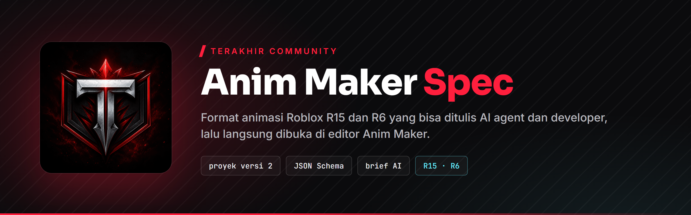
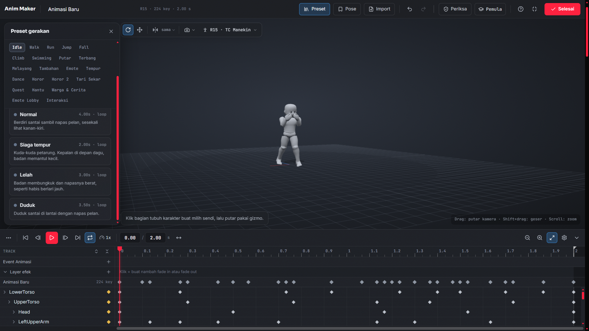
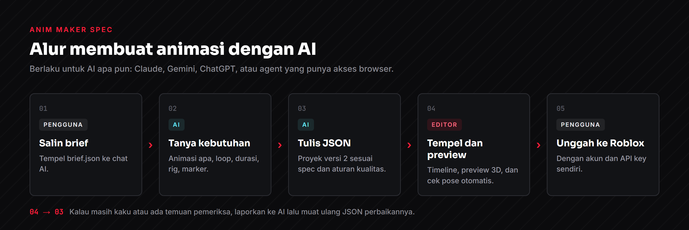
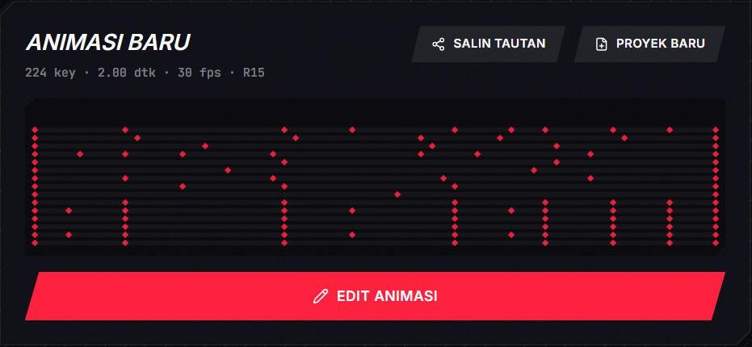

# TC Anim Maker Spec

Spesifikasi terbuka format animasi **Anim Maker Terakhir Community**, editor animasi Roblox (R15 dan R6) berbasis web.

Repo ini hanya berisi format data, aturan, dan contoh. Kode editor tidak termasuk.

## Isi

| File | Untuk |
|---|---|
| [`spec.md`](spec.md) | Penjelasan lengkap: struktur proyek, rig dan sendi, keyframe, marker, konvensi rotasi, aturan kualitas, batas. |
| [`schema.json`](schema.json) | JSON Schema untuk memvalidasi proyek secara otomatis. |
| [`brief.json`](brief.json) | Brief siap tempel ke AI mana pun (Claude, Gemini, ChatGPT) supaya AI menanyakan kebutuhan lalu membuat animasi dengan format yang benar. |
| [`contoh/`](contoh) | Contoh proyek lengkap yang bisa langsung dimuat ke editor. |

## Cara pakai dengan AI

1. Salin isi [`brief.json`](brief.json) (atau tombol **Salin brief untuk AI** di editor) lalu tempel ke chat AI.
2. Jawab pertanyaan AI tentang animasi yang Anda inginkan.
3. Salin blok JSON balasan AI, lalu di editor klik **Tempel JSON**.
4. Putar preview dan lihat hasil pemeriksaan editor. Kalau ada yang kurang, sampaikan ke AI dan ulangi.
5. Unggah ke Roblox dari editor dengan akun dan API key Anda sendiri.

AI yang punya akses ke browser Anda juga bisa langsung bekerja di halaman editor lewat `window.TCAnimMaker`.

Setelah dimuat, proyek tampil di editor lengkap dengan ringkasan key, durasi, fps, dan rig:

## Link mentah untuk AI

- Spesifikasi: `https://raw.githubusercontent.com/aldyamar112211/tc-anim-maker-spec/main/spec.md`
- Schema: `https://raw.githubusercontent.com/aldyamar112211/tc-anim-maker-spec/main/schema.json`
- Brief: `https://raw.githubusercontent.com/aldyamar112211/tc-anim-maker-spec/main/brief.json`

## Catatan

- Format ini mengikuti versi proyek `2` di editor. Perubahan format akan dicatat di repo ini.
- Animasi hanya bisa diputar di place milik akun atau grup yang sama dengan pengunggahnya.
- Batas unggah mengikuti paket akun Terakhir Community (free atau TC Supporter).
